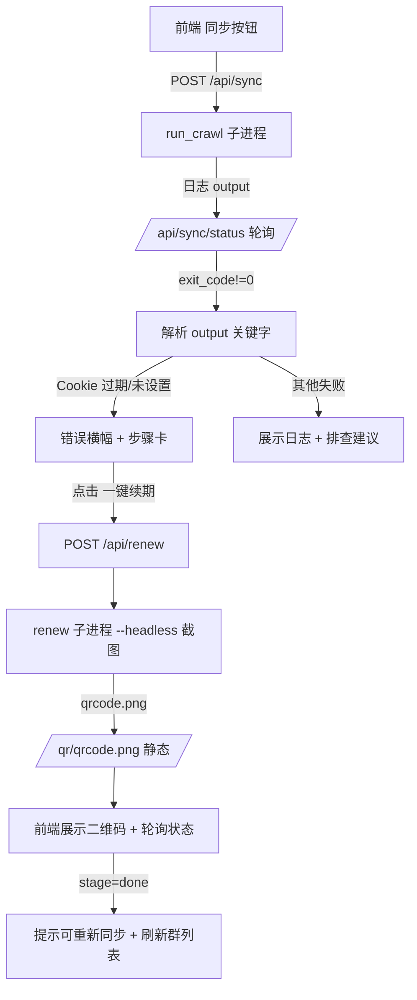

## 用户需求

点击页面顶部「同步」按钮后若未更新成功（典型原因为 Cookie 过期），当前仅显示一行灰色小字、无失败原因、无任何解决引导。需要：

1. 同步失败时给出**醒目提示**（顶部红/橙错误横幅），展示具体失败原因。
2. 提供**逐步引导解决 Cookie 过期**的可折叠步骤卡（含可复制命令、扫码说明）。
3. 支持**网页端一键触发续期**：点击后服务端直接以无头模式运行 `crawl.py --renew-cookie --headless`，前端轮询展示二维码图片并引导用户用微博 APP 扫码，扫码成功后状态转绿，可再次同步。

## 产品概述

在现有微博群聊消息查看器的「同步」功能基础上，增强失败可见性与可恢复性。同步失败时在页面顶部弹出错误横幅，自动识别失败类型（Cookie 过期 / Cookie 未设置 / 其他爬取错误），并展开可折叠的分步解决指引。其中 Cookie 类失败提供「一键续期」入口，服务端拉起无头浏览器截图二维码、前端展示二维码并轮询扫码状态，用户扫码成功后自动结束续期任务并提示可重新同步。

## 核心特性

- 同步失败醒目横幅：根据后端返回的 crawl.py 日志关键字识别失败原因，红/橙配色、可关闭。
- 可折叠分步指引卡：Cookie 过期/未设置时展示具体修复步骤（一键续期 + 终端手动命令复制）；其他失败展示日志片段与排查建议。
- 一键续期长任务：新增后端 `/api/renew` 启动无头续期子进程，前端轮询 `/api/renew/status` 获取二维码图片 URL、扫码状态与日志。
- 二维码扫码引导：前端在步骤卡内展示服务端生成的二维码图片，提示用微博 APP 扫码；检测到登录成功（状态转 `done`）后提示可重新同步并自动刷新群列表。
- 与现有同步/导出/媒体浏览功能互不干扰，续期与同步互斥（同一时刻仅一个长任务运行）。

## 技术栈

- 前端：原生 HTML + CSS + JavaScript（与现有 `web/` 完全一致，零框架、零构建）。
- 后端：Python 标准库 `http.server`（现有 `server.py`，零外部依赖），`subprocess` 复用 crawl.py。
- 数据库：复用 SQLite（config 表存 weibo_cookie），不新增表。

## 实现方案

### 整体策略

后端新增与现有同步同构的「续期长任务」机制：用一个 `_renew_state` dict + 锁 + 后台线程（读 crawl.py `--renew-cookie --headless` 子进程输出），暴露 `/api/renew`（POST 启动）、`/api/renew/status`（GET 轮询）、`/api/renew/stop`（POST 终止）。续期进程把二维码截到 `<项目根>/qrcode.png`，新增 `/qr/` 静态路由供前端访问。前端改造 `pollSync` 失败分支：解析 `output` 日志关键字分类失败，渲染错误横幅 + 可折叠步骤卡；步骤卡内「一键续期」按钮触发续期轮询，展示二维码并轮询状态。

### 关键技术决策

1. **复用 `_sync_state` 同款模式**：续期与同步都是「subprocess.Popen + 后台线程读 stdout 写入共享 dict」的长任务。新建 `_renew_state` 结构（`proc / exit_code / output / qrcode_url / stage`），避免引入新架构，降低维护成本与回归风险。
2. **强制 `--headless`**：服务器常无桌面环境，必须无头截图二维码而非弹窗。命令：`[sys.executable, "crawl.py", "--renew-cookie", "--headless"]`。
3. **二维码共享文件**：`crawl.py` 固定截图到 `QRCODE_PATH = <根>/qrcode.png`。后端新增 `/qr/` 静态映射（复用 `_serve_media_static` 的防穿越写法指向项目根），前端用 `/qr/qrcode.png?t=<mtime>` 访问并加时间戳避免缓存。无需改动 crawl.py。
4. **失败原因识别（前端纯文本匹配）**：`/api/sync/status` 的 `output` 已含 crawl.py 完整日志。匹配关键字：`Cookie 已过期` / `Cookie 未设置` → cookie 类；`爬取失败` / `CookieExpiredError` → 其他。分类决定横幅文案与步骤卡内容。
5. **互斥保护**：续期与同步共用「单一长任务」语义——启动续期前若同步在跑则先提示；续期进行中禁用同步按钮。复用 `syncInProgress` 思路新增 `renewInProgress`。

### 性能与可靠性

- 续期子进程阻塞约 120s（等待扫码），轮询间隔沿用同步的 2s，开销极低。
- 二维码图片仅在文件存在且 mtime 变化时才更新 `img.src`，避免无谓重绘。
- 续期进程异常退出（如 Playwright 未安装）→ `exit_code != 0`，前端展示失败日志与「先 `uv run playwright install chromium`」指引，不卡死。
- 后台线程 daemon 化，进程退出不残留；状态 dict 加锁读写，线程安全。

### 执行注意（防回归）

- 不改 `run_crawl` / 现有同步 API / 导出 / 媒体路由，仅新增续期相关 API 与静态路由。
- 横幅/步骤卡为新增 DOM 容器，不改动现有 `#topbar`、`#status` 语义；失败时仍保留原有状态栏文字作为次要信息。
- 二维码静态路由需做目录穿越防护（同 `_serve_media_static`），仅允许访问项目根下 `qrcode.png`。

## 架构设计



## 目录结构

```
/Users/john/jfjzsxh-weibogroup/
├── server.py              # [MODIFY] 新增续期长任务状态 _renew_state、_renew_worker、_start_renew、_renew_status；
│                           #           新增路由 POST /api/renew、GET /api/renew/status、POST /api/renew/stop；
│                           #           新增 /qr/ 静态路由（防穿越，指向项目根 qrcode.png）。
├── web/
│   ├── index.html         # [MODIFY] 在 #topbar 下方（或 body 顶部）新增错误横幅容器
│   │                      #           #error-banner（标题+原因+关闭）、#renew-panel（可折叠步骤卡：
│   │                      #           一键续期按钮、二维码 img、续期状态、手动命令复制块）。
│   ├── app.js             # [MODIFY] 改造 pollSync 失败分支调用 showSyncError(output)；
│   │                      #           新增 showSyncError/renderRenewPanel/startRenew/pollRenew/stopRenew；
│   │                      #           续期与同步互斥标志位；二维码 img 带 mtime 缓存破坏。
│   └── style.css          # [MODIFY] 新增 #error-banner（红/橙横幅）、.renew-panel（卡片/折叠）、
│                           #           .renew-qr（二维码图片样式）、.copy-cmd（命令块）等样式。
```

注：`crawl.py` 无需修改（已支持 `--renew-cookie --headless` 截图到 `QRCODE_PATH`）。

## 关键接口结构

```python
# server.py 新增的续期状态与 API 契约（仅签名/结构，不含实现体）
_renew_state = {"proc": None, "exit_code": None, "output": [], "stage": "idle"}

def _start_renew() -> bool:
    """启动 crawl.py --renew-cookie --headless 子进程；返回 False 表示已有任务在跑"""

def _renew_status() -> dict:
    """返回 {running, exit_code, output, qrcode_url, stage}
    stage: idle | waiting_scan | scanning | done | failed
    qrcode_url: /qr/qrcode.png?t=<mtime> 或 None"""

# 路由：
# POST /api/renew        -> _start_renew() 成功 202 / 冲突 409
# GET  /api/renew/status -> _renew_status()
# POST /api/renew/stop   -> kill 续期子进程
# GET  /qr/<filename>    -> 静态返回项目根下文件（防目录穿越）
```

## 设计风格

采用与现有查看器一致的浅色简洁风格（顶栏深灰 + 内容浅灰），新增的失败提示以「醒目但不破坏阅读」为原则：顶部固定错误横幅用橙红渐变背景 + 白色粗体文字，下方可折叠步骤卡为白色圆角卡片带轻微阴影。Cookie 续期区域突出二维码图片（居中、白边、轻微发光），按钮使用主色填充。

## 页面区块设计（仅消息查看器 index.html 受影响）

### 错误横幅（#error-banner）

- 位置：顶栏正下方，全宽固定条；默认隐藏。
- 样式：橙红渐变背景（#e74c3c → #c0392b），白色文字，左侧警示图标，右侧关闭按钮；圆角底部、轻投影。
- 内容：第一行粗体「同步未成功」+ 具体原因（如「Cookie 已过期，无法拉取新消息」）；第二行小字引导「点击下方步骤修复，或点此一键续期」。

### 续期步骤卡（#renew-panel，可折叠）

- 默认折叠为标题「逐步解决 Cookie 过期（点此展开）」，展开后显示：

1. 步骤一「一键续期（推荐）」：主色按钮「开始续期」，点击后展示二维码图片与状态文字（等待扫码 / 已扫描 / 成功）。
2. 步骤二「用微博 APP 扫码」：二维码图片区（#renew-qr，居中、白边），下方提示「打开微博 APP → 扫一扫 → 确认登录」。
3. 步骤三「或手动续期」：等宽字体命令块 `.copy-cmd`（含 `uv run python crawl.py --renew-cookie`），右侧复制按钮；另附「手动设置 Cookie」说明。
4. 状态区：续期进行中显示日志末尾与进度；成功显示绿色「续期成功，可重新同步」并启用同步按钮；失败显示红字与排查建议。

## 响应式

桌面优先（与现有一致）；横幅与步骤卡在窄屏下内边距自适应、二维码最大宽度 260px。

## Agent Extensions

### SubAgent

- **code-explorer**
- Purpose: 在生成详细实现前，对 server.py 的路由注册位置、_serve_media_static 防穿越写法、crawl.py 的 QRCODE_PATH 与 _renew_cookie 参数做最终精确核对，确保新增路由与静态映射不破坏现有结构。
- Expected outcome: 确认所有待修改点的精确行号与现有模式，输出可供实现直接落地的代码位置清单。